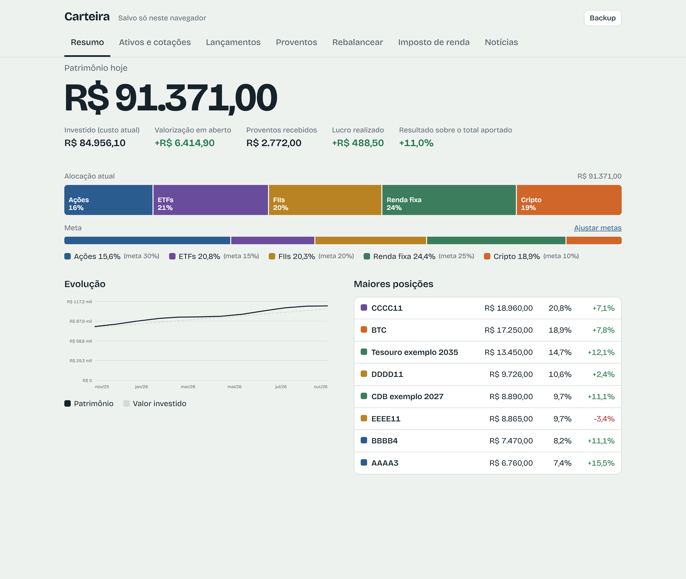
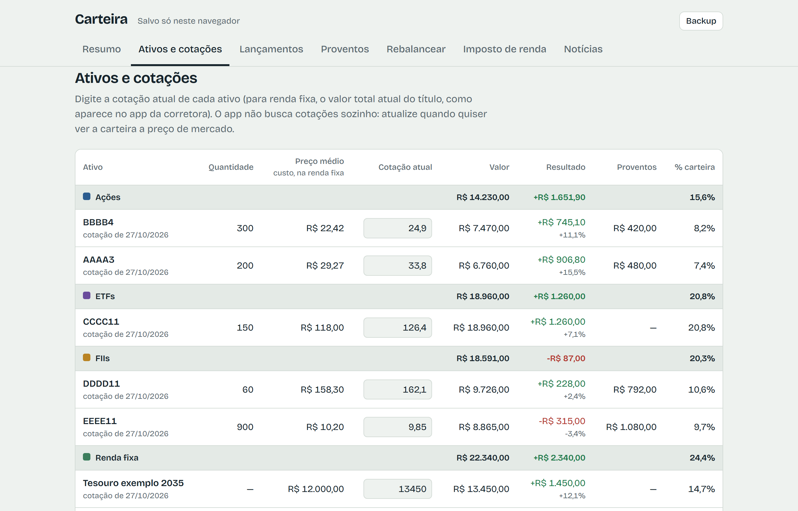
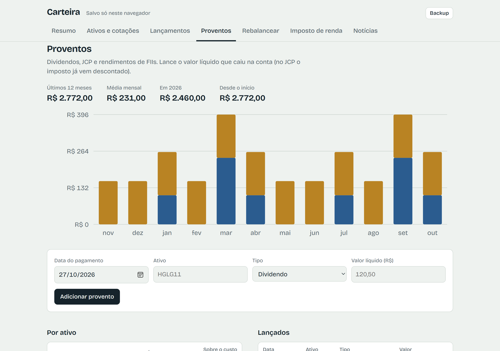
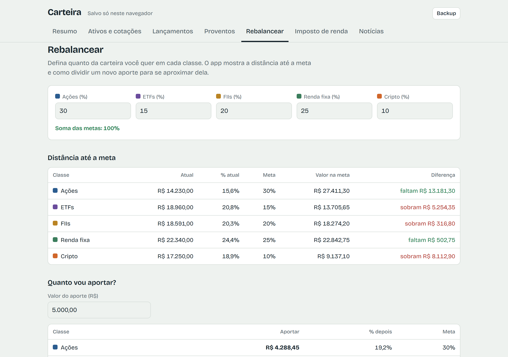
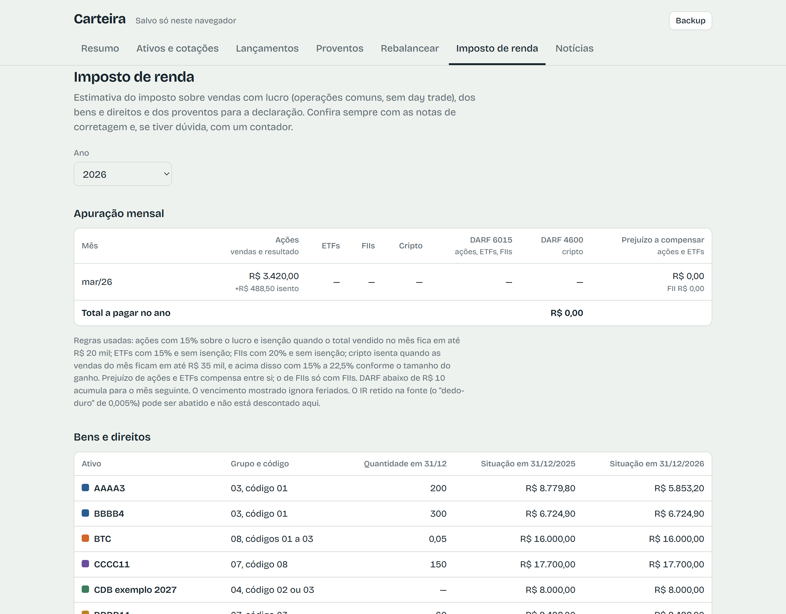
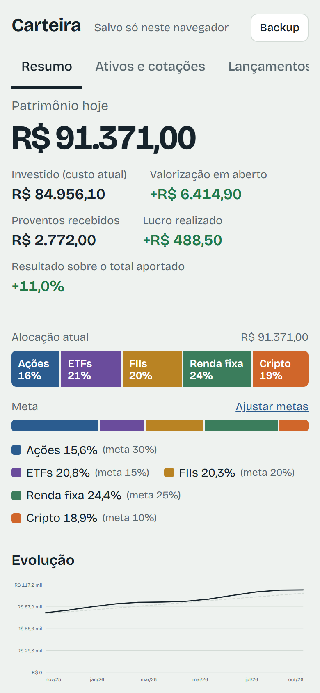

<div align="center">

# GenFin

**Sua carteira de investimentos num arquivo só.**
Preço médio, alocação, proventos, rebalanceamento e imposto de renda para quem investe na bolsa brasileira.


<br>

<picture>
  <source media="(prefers-color-scheme: dark)" srcset="docs/img/resumo-escuro.png">
  
</picture>

<sub>Capturas feitas com os dados de exemplo do próprio app. Todos os valores e códigos são fictícios.</sub>

</div>

---

## Sumário

- [O que ele faz](#o-que-ele-faz)
- [Telas](#telas)
- [Como usar](#como-usar)
- [Onde ficam os seus dados](#onde-ficam-os-seus-dados)
- [Como os números são calculados](#como-os-números-são-calculados)
- [Imposto de renda](#imposto-de-renda)
- [Desenvolvimento](#desenvolvimento)
- [Próximos passos](#próximos-passos)
- [Aviso](#aviso)

## O que ele faz

| | |
|---|---|
| 📊 **Resumo** | Patrimônio, valorização em aberto, lucro realizado, proventos e resultado sobre o total aportado. Alocação atual comparada com a meta e gráfico de evolução. |
| 💹 **Ativos e cotações** | Posição por classe com quantidade, preço médio, valor de mercado, resultado e peso na carteira. Você informa a cotação; sem ela, o ativo entra pelo preço médio. |
| 🧾 **Lançamentos** | Compras e vendas com taxas da nota de corretagem. Aplicações e resgates de renda fixa. Impede vendas maiores que o saldo, inclusive em datas retroativas. |
| 💰 **Proventos** | Dividendos, JCP e rendimentos de FIIs, com gráfico dos últimos 12 meses e rendimento sobre o custo por ativo. |
| ⚖️ **Rebalancear** | Metas por classe e sugestão de como dividir um novo aporte para se aproximar delas, só com compras. |
| 🦁 **Imposto de renda** | Apuração mensal com isenções, compensação de prejuízo e DARF; bens e direitos em 31/12; proventos do ano separados por tipo. |
| 📰 **Notícias** | Atalhos para o Google Notícias e o Status Invest de cada ativo. |

Cinco classes de ativo: **ações**, **ETFs**, **FIIs**, **renda fixa** e **cripto**.

## Telas

<table>
  <tr>
    <td width="50%"><p align="center"><sub>Ativos e cotações</sub></p></td>
    <td width="50%"><p align="center"><sub>Proventos</sub></p></td>
  </tr>
  <tr>
    <td width="50%"><p align="center"><sub>Rebalancear</sub></p></td>
    <td width="50%"><p align="center"><sub>Imposto de renda</sub></p></td>
  </tr>
</table>

<p align="center">
  <br>
  <sub>No celular, com tema claro e escuro automáticos</sub>
</p>

## Como usar

Não há instalação nem build. O app inteiro é o [`carteira.html`](carteira.html).

1. Abra o `carteira.html` no navegador.
2. Clique em **Ver com dados de exemplo** para conhecer as telas sem registrar nada, ou em **Adicionar lançamento** para começar a sua carteira.
3. Atualize as cotações na aba **Ativos e cotações** sempre que quiser ver a carteira a preço de mercado.

O app também roda como **Artifact no claude.ai**. Lá ele usa o login e o banco de dados da conta para guardar os dados e sincronizar entre aparelhos.

## Onde ficam os seus dados

```mermaid
flowchart LR
    A[Você registra<br>lançamentos, proventos,<br>cotações e metas] --> S[(Estado da carteira)]
    S --> L[localStorage<br>do navegador]
    S -. quando roda<br>no claude.ai .-> C[(Banco da conta<br>4 documentos por usuário)]
    S --> B[Backup<br>.json / .csv]
```

- **Sempre no navegador**, na chave `carteira-v1` do `localStorage`. Fora do claude.ai, os dados não saem do seu computador.
- **No claude.ai**, também na conta do usuário, em quatro documentos (`carteira`, `lancamentos`, `proventos` e `historico`). Cada salvamento leva data e hora. Ao abrir, o lado mais recente vence, para não perder alterações feitas sem conexão.
- **Backup:** o botão no topo exporta tudo em `.json`, exporta os lançamentos em `.csv` e restaura um backup. Os arquivos exportados estão no `.gitignore`, para não irem parar no repositório por engano.

## Como os números são calculados

Toda a carteira é recalculada a partir dos lançamentos, em ordem de data, pela função `calcular()`.

- **Preço médio:** o custo das compras, taxas incluídas, dividido pela quantidade. Vendas não mudam o preço médio; elas baixam o custo proporcional e geram lucro ou prejuízo realizado.
- **Renda fixa:** cada título vale pelo valor total informado (como aparece na corretora). Um resgate baixa o custo na mesma proporção do valor resgatado.
- **Resultado sobre o total aportado:** (valorização em aberto + lucro realizado + proventos) ÷ tudo o que já foi aplicado.
- **Evolução:** o patrimônio do dia é guardado sempre que você lança algo ou atualiza uma cotação.

## Imposto de renda

Operações comuns de pessoa física, sem day trade:

| Classe | Alíquota | Isenção | Compensação de prejuízo | DARF |
|---|---|---|---|---|
| Ações | 15% | Vendas de até R$ 20 mil no mês | Com ações e ETFs | 6015 |
| ETFs | 15% | Nenhuma | Com ações e ETFs | 6015 |
| FIIs | 20% | Nenhuma | Só com FIIs | 6015 |
| Cripto | 15% a 22,5%, por faixa de ganho | Vendas de até R$ 35 mil no mês | — | 4600 |

- DARF abaixo de R$ 10 acumula para o mês seguinte. O vencimento é o último dia útil do mês seguinte, sem considerar feriados.
- **Bens e direitos** saem pelo custo de aquisição em 31/12 de cada ano, com o grupo e o código da declaração.
- **Dividendos a partir de 2026 (Lei 15.270/2025):** o app avisa quando uma empresa pagou mais de R$ 50 mil em um mês, caso em que há 10% de IR retido na fonte.
- O IR retido na fonte (o "dedo-duro") não é descontado.

> [!IMPORTANT]
> É uma estimativa para conferência. Compare sempre com as notas de corretagem e com o informe de rendimentos e, na dúvida, fale com um contador.

## Desenvolvimento

```
.
├── carteira.html          # o app inteiro: HTML, CSS e JavaScript
├── tests/
│   └── carteira.test.js   # testes da lógica, com um DOM falso
├── scripts/
│   └── capturas.sh        # gera as imagens de docs/img
└── docs/img/              # capturas usadas neste README
```

Os testes rodam no Node 18 ou mais recente, sem instalar nada:

```bash
npm test
```

Eles cobrem a validação de saldo (vendas e resgates retroativos, exclusão de compras), a sincronização entre o navegador e a conta e o aviso de dividendos acima de R$ 50 mil.

Para regenerar as capturas depois de mudar a interface (precisa do Chrome ou do Edge instalado):

```bash
npm run capturas
```

## Próximos passos

- [ ] Cotações automáticas (brapi.dev para a B3, CoinGecko para cripto), mantendo a digitação manual
- [ ] Editar lançamentos, não só excluir
- [ ] Download real do backup fora do claude.ai
- [ ] Publicar no GitHub Pages

## Aviso

O GenFin é uma ferramenta de organização e cálculo. Não é recomendação de investimento, e as estimativas de imposto não substituem a orientação de um profissional.
